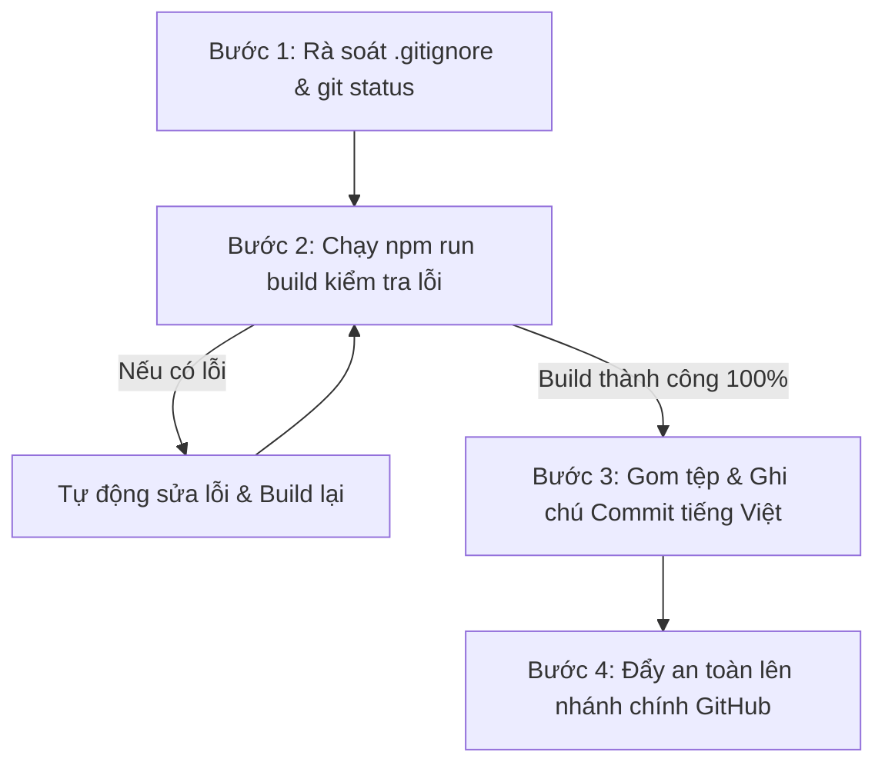

# SỔ TAY KỸ NĂNG: GIT AUTO SHIPPER
## QUY CHUẨN XUẤT BẢN & ĐỒNG BỘ MÃ NGUỒN LÊN GITHUB

> **Mục đích:** Kỹ năng này đóng vai trò là "Kỹ sư Trưởng kiểm định chất lượng xuất xưởng". Đảm bảo mọi lần đẩy mã nguồn lên GitHub đều an toàn tuyệt đối về bảo mật, không bao giờ bị lỗi sập trang và có nhật ký cập nhật mạch lạc bằng tiếng Việt.

---

### 1. QUY TẮC 1: RÀ SOÁT BẢO MẬT & BẢO VỆ TỆP BÍ MẬT (.gitignore)

Mã khóa và thông tin đăng nhập của trường là tài sản bảo mật tối cao. Tuyệt đối không bao giờ để lọt lên kho lưu trữ trực tuyến:

1. **Rà soát tệp `.gitignore` trước khi đẩy mã nguồn:**
   - Đảm bảo trong `.gitignore` luôn có các dòng chặn tệp cấu hình chứa mã khóa:
     ```gitignore
     # Các tệp biến môi trường chứa khóa bí mật
     .env*
     .env.local
     .env.production
     *.pem
     *.key
     ```
2. **Kiểm tra trạng thái tệp đang chờ (`git status`):**
   - Trước khi thực hiện lệnh gom tệp (`git add`), Agent bắt buộc phải chạy `git status` để quan sát danh sách các tệp thay đổi.
   - Nếu phát hiện bất kỳ tệp nào có chứa Access Token (`sbp_...`, `ghp_...`) hoặc Service Role Key, phải ngay lập tức loại bỏ khỏi danh sách theo dõi của Git.

---

### 2. QUY TẮC 2: KIỂM THỬ ĐÓNG GÓI BẮT BUỘC (MANDATORY BUILD CHECK)

Châm ngôn: **"Không bao giờ đẩy mã nguồn chưa được kiểm định lên GitHub!"**

1. **Chạy lệnh đóng gói sản phẩm:**
   - Agent bắt buộc phải chạy lệnh kiểm thử trên máy cục bộ:
     ```bash
     npm run build
     ```
2. **Quy trình xử lý sự cố tự động:**
   - Nếu quá trình build phát hiện lỗi (lỗi TypeScript, lỗi cú pháp, biến không tồn tại, component sai kiểu dữ liệu):
     + **Bước 1:** Phân tích chính xác dòng mã nguồn gây lỗi.
     + **Bước 2:** Tự động sửa chữa triệt để lỗi trong mã nguồn.
     + **Bước 3:** Chạy lại `npm run build` một lần nữa.
   - **Chỉ khi nào** màn hình terminal báo `✓ Compiled successfully` và kết thúc với mã thoát `0` (không còn bất kỳ lỗi nào) thì mới được phép chuyển sang bước đẩy mã nguồn.

---

### 3. QUY TẮC 3: GHI CHÚ LỊCH SỬ BẰNG TIẾNG VIỆT RÕ RÀNG (COMMIT MESSAGES)

Mọi lần cập nhật mã nguồn lên GitHub đều phải có thông điệp ghi chú rõ ràng, chuẩn ngữ pháp tiếng Việt để Tổ trưởng và các thành viên dễ dàng theo dõi tiến độ:

#### Cấu trúc thông điệp chuẩn:
```
[Tên Phân Hệ] Mô tả hành động cụ thể bằng tiếng Việt có dấu
```

#### Một số ví dụ mẫu chuẩn mực:
- `feat(ui): Khởi tạo giao diện Portal với bộ nhận diện Sky-Line và thanh lọc 5 cơ sở`
- `feat(timetable): Bổ sung ma trận Thời khóa biểu và thuật toán chống trùng lịch phòng Lab`
- `feat(db): Khởi tạo 9 bảng dữ liệu Supabase kèm khiên bảo mật Row Level Security`
- `fix(auth): Sửa lỗi mất phiên đăng nhập khi giáo viên bấm F5 tải lại trang`
- `docs: Cập nhật bản kế hoạch KE_HOACH_DU_AN.md và bộ kỹ năng dự án`

---

### 4. QUY TRÌNH 4 BƯỚC ĐỒNG BỘ MÃ NGUỒN LÊN GITHUB

Mỗi khi nhận lệnh đẩy dự án lên GitHub, Agent sẽ tự động thực hiện chuỗi 4 bước sau:



1. **Bước 1 (Kiểm tra an toàn):** Kiểm tra `.gitignore` và `git status`, đảm bảo không có tệp mật bị lộ.
2. **Bước 2 (Kiểm thử đóng gói):** Chạy `npm run build` và xác nhận không có lỗi.
3. **Bước 3 (Ghi nhận phiên bản):** Chạy `git add .` và tạo commit với thông điệp tiếng Việt cụ thể.
4. **Bước 4 (Xuất bản):** Đẩy lên kho lưu trữ GitHub của người dùng (`git push origin main` hoặc `master`).
