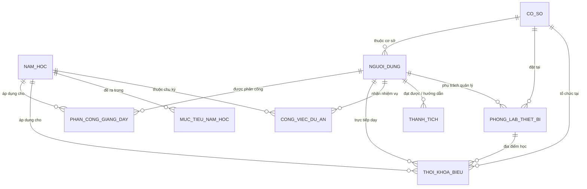
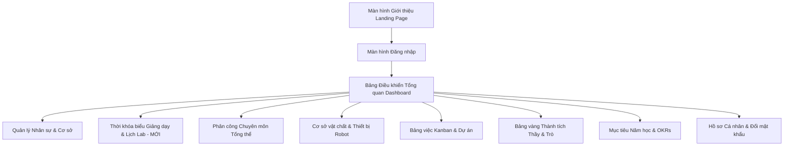
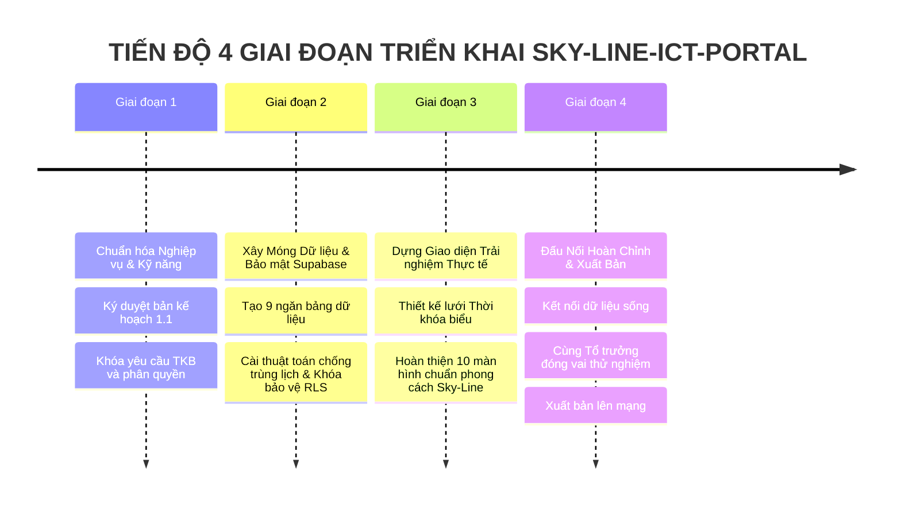

# BẢN KẾ HOẠCH DỰ ÁN TOÀN DIỆN (IMPLEMENTATION PLAN) - PHIÊN BẢN 1.1
## DỰ ÁN: CỔNG THÔNG TIN QUẢN TRỊ TỔ CHUYÊN MÔN ICT (SKY-LINE-ICT-PORTAL)

> **Người thực hiện:** Chuyên gia Phân tích Nghiệp vụ (BA) & Kiến trúc sư Trưởng  
> **Dành cho:** Giám đốc Sản phẩm / Tổ trưởng Chuyên môn ICT – Hệ thống Giáo dục Sky-Line  
> **Các quyết định thiết kế đã chốt:**
> - **Cấp tài khoản (1A):** Tổ trưởng trực tiếp tạo tài khoản trên hệ thống, giáo viên đăng nhập và tự đổi mật khẩu.
> - **Phân công & Lịch dạy (2B + Bổ sung):** Quản lý chi tiết chuyên sâu Thời khóa biểu theo từng thứ, buổi, tiết học và phòng Lab.
> - **Kiểm kê thiết bị (3A):** Cập nhật linh hoạt theo phát sinh biến động thực tế (tốt / cần sửa / hỏng).

---

## TỔNG QUAN BỐI CẢNH VÀ MỤC TIÊU DỰ ÁN

Hệ thống Giáo dục Sky-Line là trường liên cấp (từ Lớp 1 đến Lớp 12) với **5 cơ sở (Campus)**. Đặc thù của Tổ Chuyên môn ICT bao gồm:
1. **Phạm vi rộng:** Giáo viên công tác trải dài trên 5 cơ sở, quản lý học sinh từ Tiểu học đến THPT.
2. **Tài sản đặc thù:** Ngoài máy tính còn có các trang thiết bị hiện đại như Robot (VEX, Lego, Arduino), máy in 3D, thiết bị STEM tại các phòng Lab.
3. **Nhiệm vụ đa dạng:** Vừa giảng dạy chính khóa, vừa bồi dưỡng học sinh giỏi thi đấu Robothon/Tin học trẻ/KHKT, vừa quản lý phòng Lab và tham gia các dự án chuyển đổi số của nhà trường.
4. **Chu kỳ vận hành:** Vận hành chặt chẽ theo **Năm học & Học kỳ** (ví dụ: 2025-2026, 2026-2027).

**Sky-Line-ICT-Portal** sinh ra nhằm trở thành **"Bản đồ điều hành số"** thu nhỏ cho Tổ trưởng, đồng thời là **"Không gian làm việc thông minh"** cho từng giáo viên ICT trong toàn trường.

---

## PHẦN 1: THIẾT KẾ KHO DỮ LIỆU & BẢO MẬT (TRÊN NỀN TẢNG SUPABASE)
*(Mô hình 9 "Ngăn kéo hồ sơ số" thông minh)*

Hệ thống được tổ chức thành 9 ngăn bảng dữ liệu liên kết hữu cơ với nhau:

### 1. Chi tiết 9 ngăn hồ sơ (Bảng dữ liệu)

#### Ngăn 1: Danh mục Năm học (`school_years`)
- **Tên năm học:** Ví dụ "2025-2026", "2026-2027".
- **Học kỳ hiện tại:** Học kỳ 1 / Học kỳ 2 / Hè.
- **Ngày bắt đầu & Ngày kết thúc.**
- **Trạng thái:** Năm học đang diễn ra (hiện hành) hay Đã kết thúc.

#### Ngăn 2: Danh mục Cơ sở (`campuses`)
- **Tên cơ sở:** Quản lý đủ 5 cơ sở thuộc Hệ thống Sky-Line.
- **Địa chỉ & Số điện thoại hotline từng cơ sở.**
- **Số lượng phòng Lab ICT tại cơ sở.**

#### Ngăn 3: Hồ sơ Giáo viên & Nhân sự ICT (`profiles`)
*(Theo quyết định 1A: Tổ trưởng chủ động tạo tài khoản)*
- **Mã định danh cá nhân:** Gắn liền với tài khoản đăng nhập.
- **Họ và tên, Email nhà trường, Số điện thoại, Ảnh chân dung.**
- **Cơ sở trực thuộc:** Giáo viên này công tác chính tại cơ sở nào trong 5 cơ sở.
- **Vai trò trong tổ:** **Tổ trưởng chuyên môn** (bạn) hoặc **Giáo viên**.
- **Chuyên môn/Thế mạnh:** Tin học Tiểu học, Luyện thi Tin học trẻ, Lập trình Robotics VEX/Lego, Kỹ thuật phòng Lab...
- **Kiêm nhiệm:** Quản lý phòng Lab nào tại cơ sở.

#### Ngăn 4: Quản lý Cơ sở vật chất & Thiết bị Robot (`facilities_and_devices`)
*(Theo quyết định 3A: Cập nhật linh hoạt theo phát sinh biến động thực tế)*
- **Tên thiết bị / Phòng Lab:** Ví dụ "Bộ KIT Lego Spike Prime #05", "Phòng Lab ICT tầng 2", "Máy in 3D Creality #01".
- **Cơ sở đặt thiết bị:** 1 trong 5 cơ sở.
- **Phân loại:** Phòng học Lab / Bộ Robotics / Dàn máy tính / Thiết bị STEM ngoại vi.
- **Số lượng & Đơn vị tính:** Ví dụ: 15 bộ, 32 máy tính.
- **Tình trạng hoạt động:** Rất tốt / Đang sử dụng / Cần bảo trì / Báo hỏng.
- **Giáo viên chịu trách nhiệm kiểm kê.**
- **Nhật ký bảo dưỡng & sửa chữa:** Lịch sử ghi nhận khi giáo viên bấm "Báo sửa".

#### Ngăn 5: Phân công Giảng dạy Chuyên môn Tổng thể (`teaching_assignments`)
- **Năm học & Học kỳ:** Ví dụ Học kỳ 1 năm học 2026-2027.
- **Giáo viên được phân công:** Họ tên thầy/cô.
- **Cơ sở & Khối lớp:** Ví dụ Cơ sở Riverside - Khối 4 (Lớp 4/1, 4/2), Khối 11 (Lớp 11A1).
- **Môn học/Học phần:** Tin học Bộ GD&ĐT, Tin học Quốc tế, Robotics & STEM, CLB nâng cao.
- **Tổng số tiết/tuần định mức.**

#### Ngăn 6: Thời khóa biểu Giảng dạy Chi tiết & Lịch Phòng Lab (`timetables`) *(BỔ SUNG MỚI THEO YÊU CẦU 2B)*
*Ý nghĩa:* Quản trị chi tiết từng tiết lên lớp của thầy cô, tránh trùng lịch giáo viên và chống kẹt phòng Lab.
- **Năm học & Học kỳ.**
- **Thứ trong tuần:** Thứ Hai ➔ Thứ Bảy.
- **Buổi học:** Sáng / Chiều.
- **Tiết học:** Tiết 1, 2, 3, 4, 5 (kèm khung giờ quy chuẩn của Sky-Line).
- **Cơ sở giảng dạy:** 1 trong 5 cơ sở.
- **Lớp học:** Ví dụ Lớp 3/2, Lớp 7/1, Lớp 10A2.
- **Phòng học / Phòng Lab:** Dạy tại Phòng Lab ICT 1, Lab ICT 2, hay tại Lớp học tiêu chuẩn.
- **Giáo viên giảng dạy:** Thầy/cô đứng lớp.
- **Nội dung / Bài học dự kiến:** Ví dụ: "Thực hành Lập trình Scratch - Tiết 14".
- **Ghi chú đặc biệt:** Thiết bị cần chuẩn bị trước (ví dụ: Sạc sẵn 15 pin Robot).

#### Ngăn 7: Thành tích của Tổ & Học sinh (`achievements`)
- **Năm học đạt giải.**
- **Phân loại thành tích:** Cá nhân giáo viên / Học sinh bồi dưỡng.
- **Người đạt giải:** Tên giáo viên hoặc Tên học sinh + Lớp + Cơ sở.
- **Giáo viên hướng dẫn:** Ghi nhận công lao thầy/cô bồi dưỡng.
- **Cấp giải thưởng:** Cấp Trường / Quận / Thành phố / Quốc gia / Quốc tế.
- **Link ảnh minh chứng:** Giấy khen, Bằng chứng nhận, Huy chương.

#### Ngăn 8: Phân công Nhiệm vụ & Công việc (`tasks_and_projects`)
- **Tên công việc / Dự án:** Chuẩn bị Ngày hội STEM, Kiểm kê Lab, Bồi dưỡng học sinh giỏi...
- **Năm học áp dụng.**
- **Người giao việc:** Tổ trưởng.
- **Người nhận việc:** 1 hoặc nhóm giáo viên.
- **Hạn chót hoàn thành (Deadline):** Ngày & giờ cụ thể.
- **Mức độ ưu tiên:** Khẩn cấp (Đỏ) / Quan trọng (Vàng) / Bình thường (Xanh).
- **Trạng thái 4 nấc:** *Chưa làm ➔ Đang làm ➔ Chờ duyệt ➔ Hoàn thành*.
- **Link sản phẩm nộp báo cáo.**

#### Ngăn 9: Mục tiêu Năm học của Tổ (`annual_goals`)
- **Tên mục tiêu chiến lược:** Chỉ tiêu thi đua mà Tổ trưởng cam kết với Ban Giám Hiệu.
- **Năm học áp dụng.**
- **Chỉ tiêu định lượng & Tỷ lệ hoàn thành (%).**
- **Trạng thái:** Đang bám sát / Chậm tiến độ / Đạt xuất sắc.

---

### 2. Cơ chế Bảo mật & Phân quyền riêng tư ("Chìa khóa thông minh")

| Khu vực thông tin | Quyền hạn của Tổ trưởng (Bạn) | Quyền hạn của Giáo viên (Thành viên) |
| :--- | :--- | :--- |
| **Quản trị Tài khoản (1A)** | Tạo tài khoản mới, cấp mật khẩu mặc định, chỉnh sửa vai trò | Đăng nhập lần đầu tự đổi mật khẩu, sửa thông tin cá nhân |
| **Thời khóa biểu & Phân công (2B)** | Xếp TKB, đổi tiết, điều chỉnh phòng Lab cả 5 cơ sở | Xem TKB cá nhân, xem lịch phòng Lab để đặt trước |
| **Cơ sở vật chất & Thiết bị (3A)** | Xem toàn bộ tài sản 5 cơ sở, duyệt mua sắm/thanh lý | Bấm nút "Báo hỏng / Cần bảo trì" khi phát sinh sự cố |
| **Nhiệm vụ & Báo cáo** | Giao việc, gia hạn, nghiệm thu sản phẩm | Nhận việc, cập nhật tiến độ, nộp link sản phẩm |
| **Bảng vàng thành tích** | Duyệt và công bố thành tích toàn trường | Tự đăng ký báo cáo thành tích của mình và học sinh |
| **Mục tiêu năm học** | Thiết lập, điều chỉnh mục tiêu đầu năm | Xem mục tiêu chung của tổ để nắm định hướng |

---

## PHẦN 2: PHÂN TÍCH TRẢI NGHIỆM NGƯỜI DÙNG & DANH SÁCH MÀN HÌNH

### Chi tiết các màn hình cụ thể:

### 1. Màn hình Giới thiệu (Landing Page)
- Thiết kế hiện đại mang bản sắc công nghệ Sky-Line.
- Giới thiệu tổ ICT: 5 cơ sở – 12 khối lớp.
- Nút bấm chính: `[Đăng nhập vào Hệ thống]`.

### 2. Màn hình Đăng nhập (Login Screen)
- Nhập Email trường và Mật khẩu.
- Sau khi đăng nhập: Hệ thống tự nhận diện Tổ trưởng (vào Bảng điều khiển Quản trị) hoặc Giáo viên (vào Không gian làm việc cá nhân).

### 3. Màn hình Bảng Điều khiển Chính (Dashboard Tổng quan)
- Thanh chọn **Năm học & Học kỳ** (Header) và nút chuyển giao diện **Sáng/Tối `[☀️/🌙]`**.
- **Lịch dạy hôm nay (Widget thông minh):** Hôm nay giáo viên có tiết ở lớp nào, phòng Lab nào.
- **Thẻ chỉ số nhanh:** Số giáo viên đang hoạt động, Tổng số tiết/tuần, Số bộ Robot sẵn sàng, Tỷ lệ việc hoàn thành.
- **Cảnh báo khẩn:** Việc sắp trễ hạn, thiết bị báo hỏng cần xử lý.

### 4. Màn hình Thời khóa biểu Giảng dạy & Lịch Phòng Lab (Timetable & Lab Schedule) *(MỚI)*
- **3 chế độ xem thông minh:**
  + **Xem theo Giáo viên:** Chọn tên giáo viên ➔ Hiển thị lưới TKB cả tuần (Thứ 2 đến Thứ 7) của riêng thầy/cô đó.
  + **Xem theo Phòng Lab:** Chọn Phòng Lab cơ sở nào ➔ Thấy ngay khung giờ phòng đang trống để giáo viên khác đăng ký mượn thực hành.
  + **Xem theo Khối Lớp:** Xem lịch học môn Tin/Robot của các lớp từ Lớp 1 đến Lớp 12.
- **Nút bấm Tổ trưởng:** `[+ Xếp lịch tiết mới]`, `[Nhập từ Excel TKB]`, `[Sao chép TKB sang tuần mới]`, `[In Thời khóa biểu PDF]`.
- **Hệ thống Cảnh báo Đỏ:** Tự động phát hiện và báo lỗi nếu:
  + Cùng 1 giáo viên bị xếp dạy 2 lớp ở cùng 1 tiết.
  + Cùng 1 phòng Lab bị xếp cho 2 lớp cùng sử dụng ở 1 tiết.

### 5. Màn hình Phân công Chuyên môn Tổng thể (Teaching Allocations)
- Bảng ma trận chuyên môn: Thống kê định mức số tiết dạy/tuần của từng giáo viên trên từng khối lớp.
- Giúp Tổ trưởng cân đối khối lượng công việc, không để thầy cô nào quá tải hoặc thiếu tiết.

### 6. Màn hình Quản trị Nhân sự & Đội ngũ (Team Management)
- Nút bấm Tổ trưởng: `[+ Cấp tài khoản Giáo viên mới]` (nhập họ tên, email, cơ sở, mật khẩu mặc định).
- Danh sách giáo viên theo dạng thẻ danh thiếp: Xem chuyên môn, phòng Lab phụ trách, số tiết dạy/tuần.

### 7. Màn hình Quản trị Cơ sở vật chất & Thiết bị Robot (Lab & Device Hub)
- Thẻ 5 Cơ sở: Lọc thiết bị theo từng điểm trường.
- Nút bấm giáo viên: `[Báo cần sửa chữa / Báo hỏng]` (chụp ảnh đính kèm mô tả lỗi cánh tay robot, lỗi máy tính...).
- Nút bấm Tổ trưởng: `[+ Khai báo thiết bị mới]`, `[Xác nhận đã bảo dưỡng xong]`.

### 8. Màn hình Bảng việc Kanban & Dự án (Task Board)
- 4 cột trực quan: *Cần làm | Đang làm | Chờ duyệt | Hoàn thành*.
- Giáo viên kéo thẻ việc hoặc dán link nộp bài báo cáo 1 chạm.

### 9. Màn hình Bảng vàng Thành tích (Achievements Wall)
- Khung danh dự trưng bày cúp 🏆, giấy khen của Thầy cô và Học sinh qua các kỳ thi Robothon, Tin học trẻ, WRO.

### 10. Màn hình Mục tiêu Năm học (Annual Goals)
- Thanh tiến độ % trực quan cho từng mục tiêu lớn của tổ trong năm học.

---

## PHẦN 3: DANH SÁCH TÍNH NĂNG CỐT LÕI

1. **Quản trị Thời khóa biểu thông minh (Chống trùng lịch tự động):**
   - Xếp lịch theo Thứ / Tiết / Phòng Lab / Lớp / Giáo viên.
   - Báo động đỏ khi phát hiện trùng giáo viên hoặc trùng phòng Lab.
   - Xuất file in TKB cá nhân cho từng giáo viên.
2. **Cấp tài khoản & Quản lý nhân sự chủ động (Chuẩn 1A):**
   - Tổ trưởng tự tạo tài khoản nội bộ, không cần quy trình phức tạp.
   - Phân quyền tự động ngay sau khi đăng nhập.
3. **Báo cáo tình trạng thiết bị 1 chạm (Chuẩn 3A):**
   - Giáo viên phát hiện Robot hỏng hoặc máy tính trục trặc chỉ cần 5 giây bấm nút "Báo sự cố" ngay trên điện thoại hoặc máy tính.
4. **Quản lý linh hoạt theo Năm học & Học kỳ:**
   - Dễ dàng chuyển đổi xem dữ liệu các năm học cũ hoặc chuẩn bị cho năm học mới.
5. **Bộ lọc đa chiều 5 Cơ sở & Khối 1 - 12:**
   - Lọc dữ liệu tức thì không cần tải lại trang.
6. **Cá nhân hóa Giao diện (Sáng / Tối):**
   - Đổi tông màu bảo vệ mắt khi làm việc buổi tối.
7. **Lưu trữ Minh chứng Đám mây:**
   - Đính kèm hình ảnh bằng khen, minh chứng sửa chữa thiết bị vĩnh viễn không lo thất lạc.

---

## PHẦN 4: LỘ TRÌNH TRIỂN KHAI 4 GIAI ĐOẠN ("XÂY MÓNG TRƯỚC - DỰNG NHÀ SAU")

### Giai đoạn 1: Chuẩn bị Bộ Kỹ năng & Chuẩn hóa Nghiệp vụ (HIỆN TẠI)
- Ký duyệt Bản Kế Hoạch 1.1 giữa Tổ trưởng (Bạn) và Đội ngũ Kỹ thuật.
- Chuẩn bị sẵn danh sách các khối lớp Sky-Line (từ Lớp 1 đến 12), danh mục 5 cơ sở và khung tiết học chuẩn của trường.

### Giai đoạn 2: Khởi tạo Cơ sở Dữ liệu & Khóa Bảo mật trên Supabase
- Khởi tạo đầy đủ 9 bảng hồ sơ số trên Supabase đám mây.
- Cài đặt quy tắc phân quyền: Tổ trưởng toàn quyền, giáo viên bảo mật thông tin riêng.
- Nạp sẵn dữ liệu mẫu thực tế của 5 cơ sở Sky-Line để thử nghiệm tính năng xếp thời khóa biểu và giao việc.

### Giai đoạn 3: Thiết kế Giao diện Trực quan Khớp nối Dữ liệu
- Dựng giao diện chuyên nghiệp, đẳng cấp với tông màu nhận diện Sky-Line.
- Thiết kế lưới Thời khóa biểu trực quan (kéo thả hoặc chọn ô tiện lợi).
- Tích hợp đầy đủ chế độ Giao diện Sáng/Tối (Light/Dark mode).

### Giai đoạn 4: Đấu nối Toàn diện, Kiểm thử & Xuất bản lên Internet
- Đấu nối giao diện với kho dữ liệu Supabase, đảm bảo mọi thao tác lưu và hiển thị ngay tức thì.
- Cùng Tổ trưởng đăng nhập thử nghiệm thực tế: tạo thử tài khoản giáo viên, xếp thử thời khóa biểu, giao thử một công việc, báo thử một thiết bị hỏng.
- Xuất bản lên môi trường Web trực tuyến an toàn để toàn bộ giáo viên 5 cơ sở sử dụng thuận tiện.

---

## BƯỚC TIẾP THEO

Bản kế hoạch chi tiết (Phiên bản 1.1) đã đáp ứng trọn vẹn:
- Các lựa chọn **1A**, **2B**, **3A** của bạn.
- Bổ sung hoàn chỉnh phân hệ **Quản trị Thời khóa biểu giảng dạy & Lịch sử dụng phòng Lab**.

Nếu bạn thấy bản kế hoạch này đã hoàn toàn khớp với mong đợi, xin mời bạn cho ý kiến xác nhận (ví dụ: *"Đồng ý, hãy bắt đầu Giai đoạn 1"* hoặc *"Tiến hành tiếp theo"*), chúng ta sẽ chính thức bắt đầu từng bước vững chắc!
